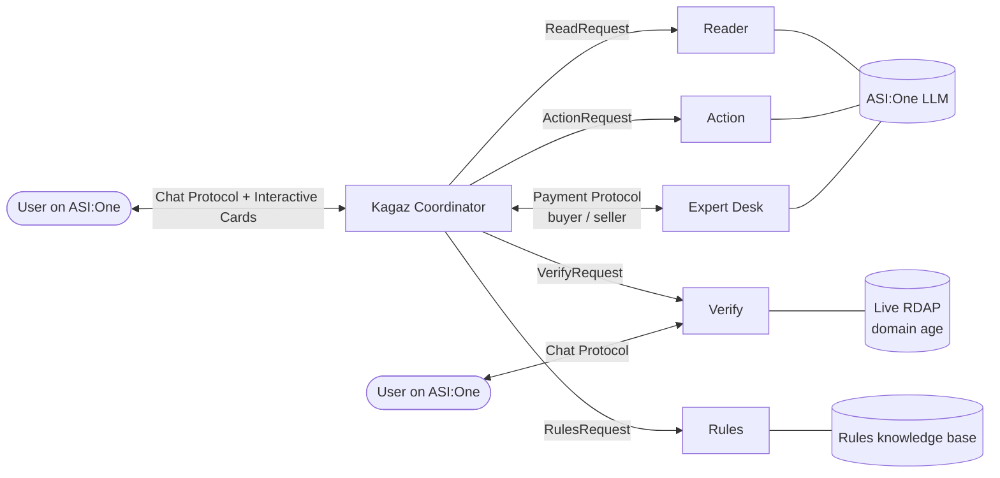

# Kagaz AI: any official notice, turned into action


**"Notice mila? Kagaz ko de do."** Paste any official notice or SMS into ASI:One,
or upload a **screenshot or photo** of it:
a traffic e-challan, an income tax notice, an electricity disconnection notice,
a bank letter. A team of six Fetch.ai agents:

1. **Verifies it**: is it genuine, suspicious, or a scam?
2. **Explains it** in plain English or Hindi, grounded in the real rules
3. **Drafts your reply** and lists the exact official steps
4. **Reminds you** before the deadline
5. **Gets an expert review**, paid agent-to-agent with the Payment Protocol
6. **Fights back against scams**: a ready-to-file cybercrime.gov.in complaint and a
   WhatsApp warning for your family, in English and Hindi

## Try it live (no install)

Kagaz runs 24/7 on Agentverse. You chat with it inside ASI:One:

1. Open **[asi1.ai](https://asi1.ai)** in a browser (desktop or phone browser; the ASI:One mobile app doesn't support custom agents yet) and sign in.
2. Type **`@kagaz`** and paste any notice or SMS. Try one from [`samples/`](samples), or this:
   `This is CBI officer. A parcel in your name has drugs. You are under digital arrest. Transfer Rs 50,000 to RBI safe account today.`
3. Or open the **[Kagaz Coordinator on Agentverse](https://agentverse.ai/agents/details/agent1qwvc8wrwftwgzlanhhc6k5pq55ukqet5yw7jsej6aqyrlt3ull46u4zrqya/profile)** and click **Chat with Agent**.

Server status: [kagaz-ai-wrgn.onrender.com](https://kagaz-ai-wrgn.onrender.com). The first reply can take up to a minute if the free server was asleep.

Built for Fetch-A-Thon 3.0 (GCET edition) with uAgents, Agentverse, ASI:One,
the Agent Chat Protocol, ASI:One Interactive Cards and the Agent Payment Protocol.

## The problem

- Crores of Indians receive notices they can't parse, miss deadlines and pay penalties.
- Fake notices are a major fraud channel: fake e-challan links, fake income tax
  refunds, fake electricity disconnection SMS. People pay scammers because they
  cannot tell real from fake.
- Existing tools cover one slice each: tax-notice drafting for CAs, or generic
  scam-link checkers. Nobody verifies, explains, acts and escalates in one flow,
  for every kind of notice, for ordinary citizens.

## Agent architecture



| Agent | Role | Fetch.ai features |
|---|---|---|
| **Coordinator** | Talks to the user, plans the steps, routes work, runs reminders, pays the expert | Chat Protocol, Interactive Cards (review, form, detail, custom), Payment Protocol (buyer), `on_interval` reminders |
| **Reader** | Reads text and screenshots/photos (OCR); extracts type, issuer, amount, deadline, references, links | Chat Protocol image attachments, Tesseract OCR, ASI:One LLM + deterministic extraction |
| **Verify** | Scam detection: look-alike domains, shorteners, APK/OTP/UPI asks, pressure tactics, live domain age | Live RDAP lookup, ASI:One second opinion, **also its own Chat Protocol endpoint** |
| **Rules** | Plain-language explanation grounded in a curated rules base; decides when to escalate | Retrieval-grounded ASI:One generation |
| **Action** | Draft reply letter, ordered steps, reminder dates | ASI:One LLM + safe templates |
| **Expert Desk** | Paid review of the draft | Payment Protocol (seller) |

### The flow inside ASI:One

1. User pastes a notice. Coordinator calls **Reader**, then **Verify**.
2. Scam: a **custom card** shows the risk score, reasons, and what to do (1930, cybercrime.gov.in).
   Genuine: a **review card** shows what was read, for the user to confirm or correct (**form card**).
3. Coordinator calls **Rules** and **Action**. The user gets the explanation, steps, draft letter
   and a **detail card** with next actions.
4. "Set reminders": the coordinator messages the user on the reminder dates.
5. "Get expert review": a **review card** confirms the fee. The coordinator and Expert Desk settle it with
   `RequestPayment -> CommitPayment -> CompletePayment`, and the review arrives in chat.

### Reliability

- Every specialist call has a timeout. If a specialist is down, the coordinator runs the
  same step in-process and tells the user, so the conversation never dead-ends.
- Hard facts (amounts, dates, references, links) come from deterministic extraction; the LLM
  cannot overwrite them. Explanations are grounded in the rules base only.
- Live checks that fail (no network, unregistered domain) are reported, never fatal.
- The coordinator rejects invoices that don't match a pending request or exceed the agreed fee.

## Run it

Requires Python 3.10+, an ASI:One API key (log in at [asi1.ai](https://asi1.ai) -> Developer section -> Create New) and an
[Agentverse](https://agentverse.ai) account.

```bash
python -m venv .venv && source .venv/bin/activate   # Windows: .venv\Scripts\activate
pip install -r requirements.txt
cp .env.example .env        # add ASI1_API_KEY and your own long random seeds
```

**Option A: one process (quickest)**. Coordinator on Agentverse, specialists in-process:

```bash
python run_local.py
```

**Option B: full Agentverse**. Each agent in its own process with its own Agentverse profile:

```bash
python run_all.py
```

On first run, open each agent's **inspector link** from the logs, click
**Connect -> Mailbox**, then open the Coordinator's **Agent Profile -> Chat with Agent**
to use it in ASI:One.

### Tests

```bash
python -m pytest -q                                   # core logic, offline
python -m tests.e2e_local                             # full multi-agent flow, offline
```

The end-to-end test runs all six agents plus a simulated ASI:One user. The user clicks
through the scam flow and the genuine-notice flow, including reminders and the paid expert review.

### Demo inputs

`samples/` has five notices: a fake e-challan SMS, a fake tax refund SMS, a genuine
income tax 143(1) intimation, an electricity disconnection notice and a SARFAESI 13(2) bank notice.

### Run 24/7 in the cloud

The agents run wherever the code runs. To keep Kagaz online without a laptop, deploy the
root `Dockerfile`. It runs all six agents in one process (about 100 MB of memory), serves a
small health page on `$PORT`, and pings its own public URL every 5 minutes so free plans
don't put it to sleep.

**Render (free):** New → Blueprint → pick this repo. Render reads `render.yaml`; paste
`ASI1_API_KEY` and the six `KAGAZ_*_SEED` values from your `.env` when asked (same seeds =
same agent addresses). Then stop any local copy: only one copy should read the
coordinator's mailbox.

**Any other Docker host** (Railway, Fly.io, a VM): build the `Dockerfile` with the same
environment variables, and set `KAGAZ_KEEPALIVE_URL` if the host sleeps when idle.
`deploy/huggingface/` has a Space setup for hosts that support Docker Spaces.

## Agents

**Live 24/7:** the agents run on Render ([status page](https://kagaz-ai-wrgn.onrender.com)). Chat with `@kagaz` on ASI:One (web).


Talk to Kagaz on ASI:One through the **Coordinator**. The **Verify** agent can also be used on its own.
Each address is fixed by its private seed.

| Agent | Address | Agentverse profile |
|---|---|---|
| Kagaz Coordinator | `agent1qwvc8wrwftwgzlanhhc6k5pq55ukqet5yw7jsej6aqyrlt3ull46u4zrqya` | [profile](https://agentverse.ai/agents/details/agent1qwvc8wrwftwgzlanhhc6k5pq55ukqet5yw7jsej6aqyrlt3ull46u4zrqya/profile) |
| Kagaz Reader | `agent1qtjw2au76rw2ff9m800x5ntn33xrpfhlaky4f6hfujwgqvfsaatdzdayz2v` | runs with the Coordinator (`run_all.py` gives it its own profile) |
| Kagaz Verify | `agent1qdtcq0dwcttl7xnw4rzl0zdjepzlxkc67ts9gzvn3fmxr5fqm3csu52rfqn` | runs with the Coordinator (`run_all.py` gives it its own profile) |
| Kagaz Rules | `agent1qwsh25v2m9xut4mklgt6scuzn3prxrs5d7qh88ttkgcshtg0rl6yu577xvj` | runs with the Coordinator (`run_all.py` gives it its own profile) |
| Kagaz Action | `agent1q2wf6asmghlw3pkc7zv58tx3ncln0fpf9pfhmpcdsrkv5uj4rgawkzjucq3` | runs with the Coordinator (`run_all.py` gives it its own profile) |
| Kagaz Expert Desk | `agent1qda68rafn0axayysd926uwdqzzpsqxdgapc4ykqrwrapcrdv7aqlg8xch3l` | runs with the Coordinator (`run_all.py` gives it its own profile) |

## Business model

- **Free**: verification, explanation, draft and reminders, so scam protection reaches everyone.
- **Paid expert review** (Rs 99 per notice): verified CAs and lawyers join as Expert agents on
  Agentverse and are paid per job through the Payment Protocol. Kagaz keeps a platform fee.
- **B2B**: banks, DISCOMs and police can register official agents so citizens can verify
  notices against the issuer directly.

## Prototype limits (honest list)

- Expert reviews are AI-assisted and labelled; production routes them to human professionals.
- Payments use demo transaction ids by default. Set `KAGAZ_REAL_FET=true` with a funded
  testnet wallet for real FET transfers.
- The rules base covers six notice types. Unknown notices get generic safe guidance and are
  escalated.
- Photos and screenshots are read with Tesseract OCR (English + Hindi), with ASI:One as a
  fallback. PDFs need a screenshot or pasted text for now.

*Kagaz gives general information, not legal advice.*
