# Kagaz AI in screenshots

Real replies from the Kagaz agents (captured from the end-to-end test run).

| | |
|---|---|
| 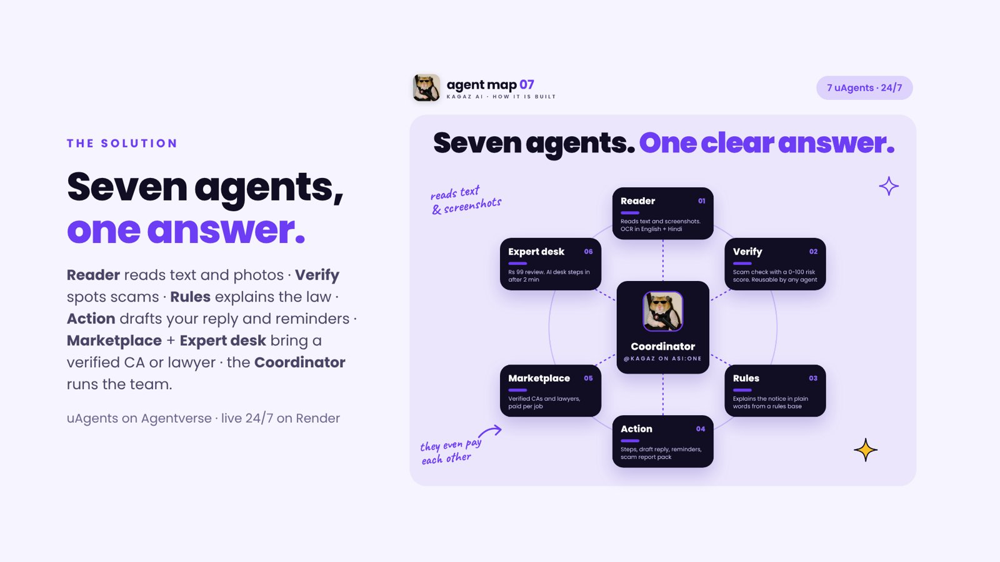 | 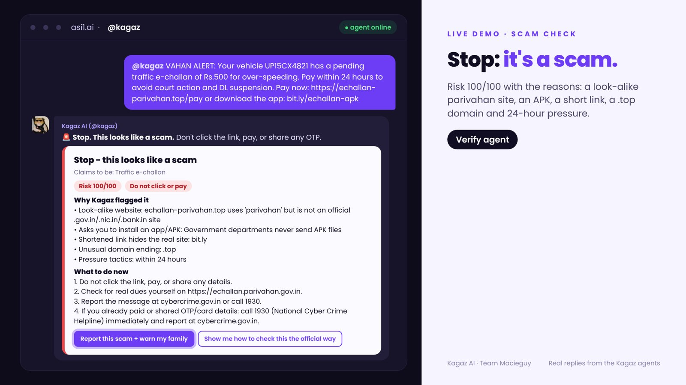 |
| Seven Fetch.ai agents, team or solo | A fake challan SMS: scam, 100/100 |
| 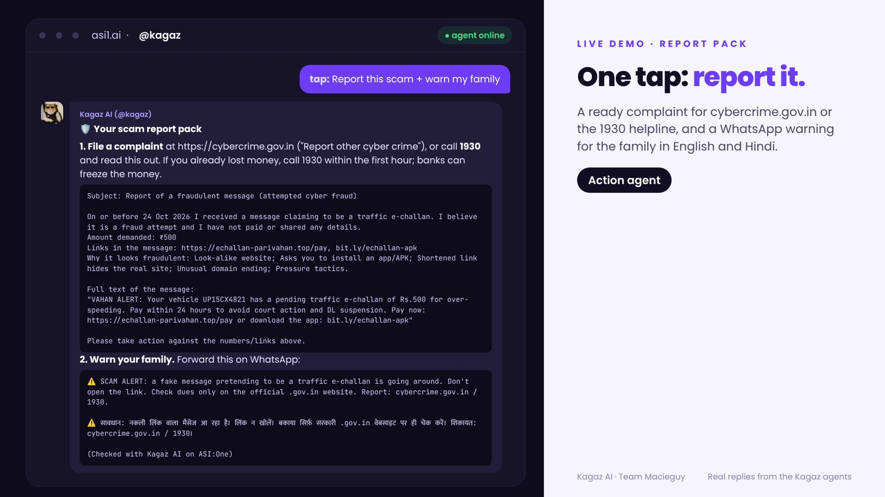 | 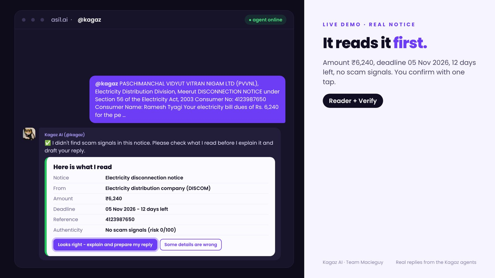 |
| Ready complaint + family warning | "Here is what I read" confirm card |
| 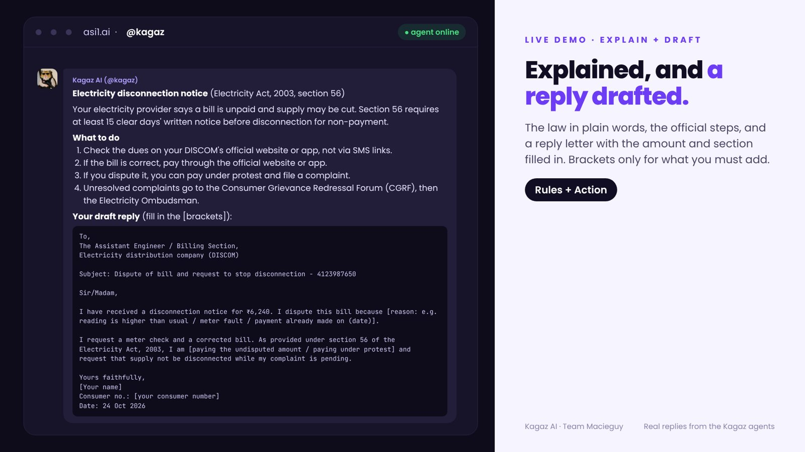 | 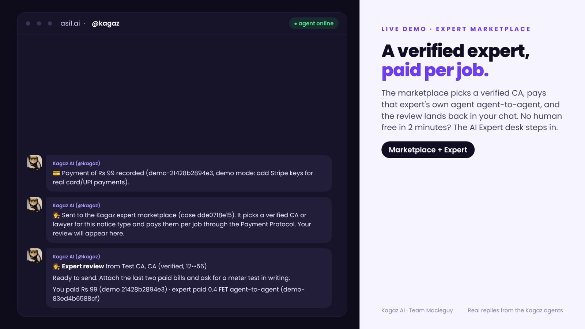 |
| Plain explanation + reply letter | ₹99 review by a verified CA |
| 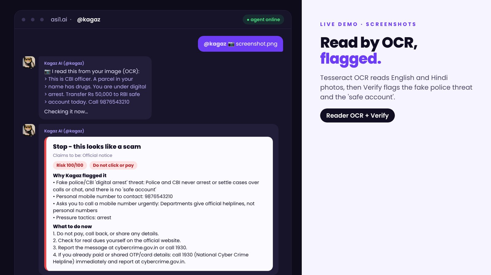 | 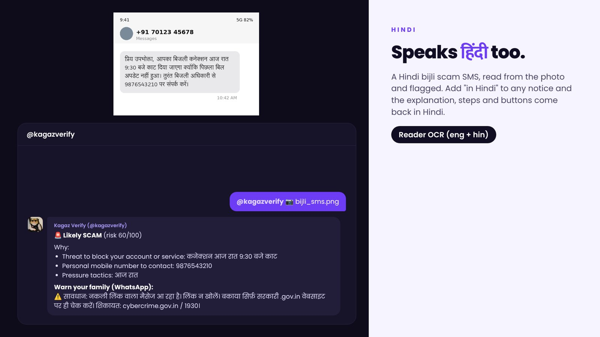 |
| Screenshot upload, read with OCR | Hindi scam SMS caught |
| 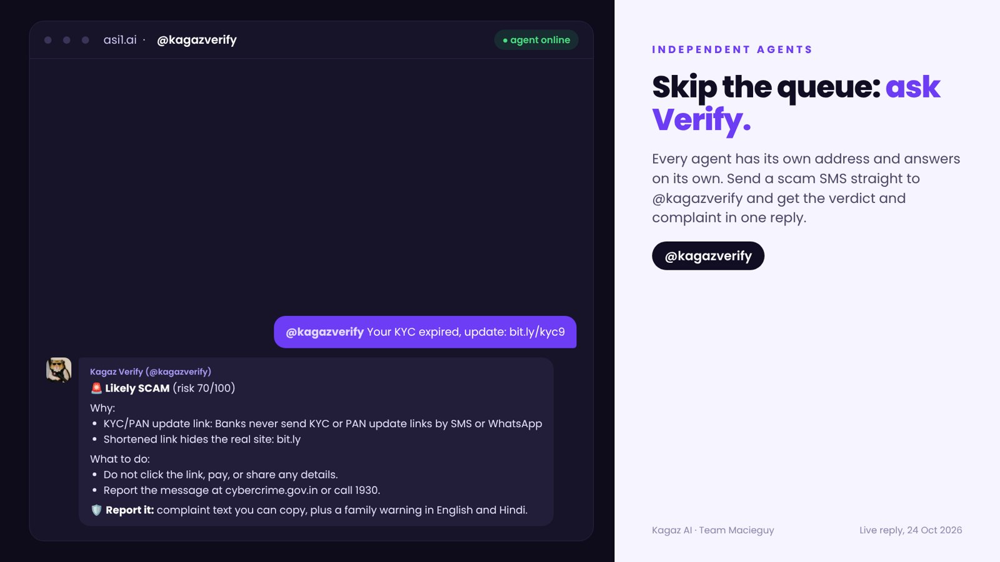 | 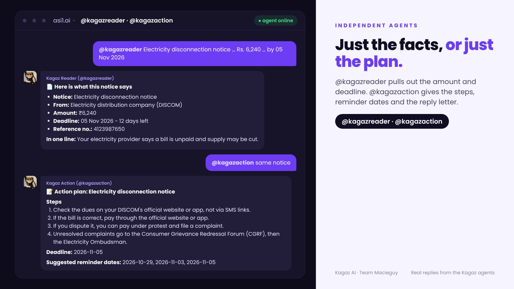 |
| `@kagazverify` on its own | `@kagazreader` and `@kagazaction` on their own |
| 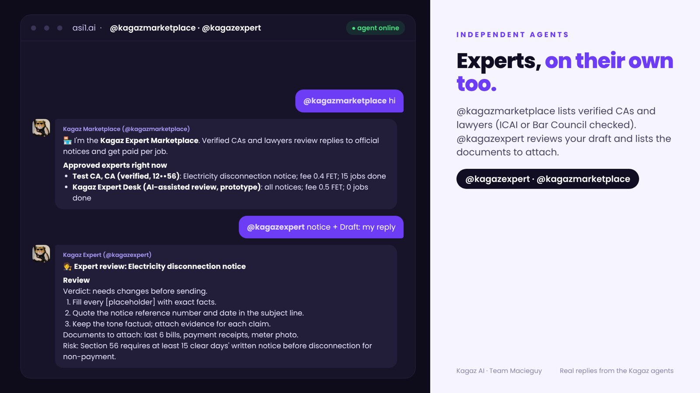 | 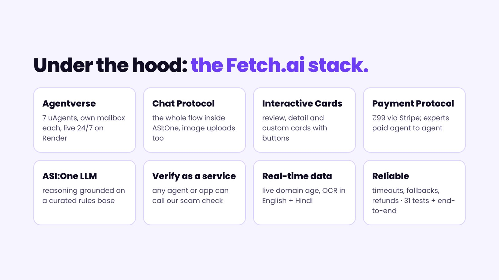 |
| `@kagazmarketplace` and `@kagazexpert` | The Fetch.ai stack we use |

Demo video voice-over script: [VIDEO.md](VIDEO.md).
